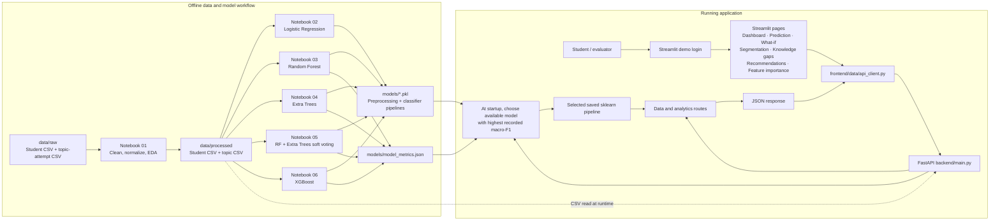

# LearnIQ: Project and PBL Viva Guide

This document explains the implemented LearnIQ MVP from its problem definition and data through model training, backend, frontend, practical use, evaluation, limitations, and presentation preparation.

## 1. Project at a Glance

**Project name:** LearnIQ — Personalized Learning and Student Performance Prediction System  
**Project type:** Machine-learning web application  
**Primary task:** Multiclass classification of a student's `performance_category`  
**Other analytics:** Topic-level knowledge gaps, score-based practice suggestions, student clustering, and what-if category comparisons

LearnIQ combines academic and study-behavior records with topic-attempt data. It trains several candidate classifiers, selects the available model with the best recorded macro-F1 score, and serves predictions and analytics through a FastAPI backend and Streamlit interface.

### One-sentence definition

> LearnIQ is a student-learning analytics MVP that uses academic and study-behavior features to classify performance categories and provide topic-level insights through an interactive dashboard.

### What the model predicts

The primary target is **`performance_category`**, with four observed labels: `average`, `excellent`, `good`, and `poor`. This is a classification problem. The current model does **not** predict a student's exact final mark as a regression value.

The API also returns estimated probabilities for each category and derives a simple risk label from the predicted category. The probability is a model estimate, not a guarantee, and it has not been separately calibrated.

## 2. Problem and Motivation

Students and educators may have many academic indicators but no quick way to combine them into a consistent overview. Marks, attendance, study habits, and topic performance can be difficult to review together.

LearnIQ demonstrates how those records can be used to:

- estimate a performance category from existing student features;
- show the model's category probabilities;
- summarize student and topic data;
- flag topics with low scores;
- suggest simple practice actions for those topics;
- explore how the model output changes when selected inputs change; and
- group students with similar study and academic profiles.

The intended users for the MVP are students, educators, and project evaluators. In a real institution, it should support human review rather than automatically making high-stakes decisions about students.

## 3. Data Used

The README links the project to the [Student Academic Performance Dataset on Kaggle](https://www.kaggle.com/datasets/ayushraj41/student-academic-performance-dataset). The repository's `data/raw/` directory currently contains student-performance and topic-attempt CSV files.

The processed files currently inspected in this repository contain:

| Dataset | Rows | Columns | Meaning |
|---|---:|---:|---|
| Student performance | 5,000 | 20 | One student-level record per student |
| Topic attempts | 40,000 | 7 | Topic scores and study/attempt details |

All 5,000 student IDs appear in both processed datasets. The processed files had no missing cells in the inspection used to prepare this guide. Dataset contents can change, so rerun the preprocessing notebook to refresh these figures after replacing the raw files.

### Student-level columns

| Column | Role or interpretation |
|---|---|
| `student_id` | Record identifier; excluded from classifier features |
| `age`, `grade_level` | Student context |
| `previous_marks` | Prior academic performance |
| `attendance_pct` | Attendance percentage |
| `study_hours_per_week`, `study_days_per_week`, `study_consistency_pct`, `study_frequency` | Study behavior |
| `sleep_hours_per_night` | Reported sleep duration |
| `quiz_average`, `assignment_average` | Assessment features |
| `missed_assignments`, `average_attempts` | Assignment and attempt behavior |
| `learning_style`, `internet_access` | Categorical/availability features |
| `final_marks`, `passed`, `risk_level` | Outcome-related columns; excluded from model inputs to reduce target leakage |
| `performance_category` | Classification target |

### Topic-attempt columns

| Column | Meaning |
|---|---|
| `student_id` | Links attempts to a student |
| `topic` | Topic name |
| `topic_difficulty` | Dataset difficulty value |
| `topic_score` | Student's score for the topic |
| `attempt_count` | Attempts associated with that topic record |
| `study_minutes` | Study time associated with the topic record |
| `mastery_level` | Dataset-provided mastery label |

## 4. End-to-End Architecture

The notebooks are the offline training workflow. FastAPI and Streamlit form the running application. The backend reads the processed CSV files and the best available saved model at startup.



### Repository map

```text
app.py                         Streamlit application entry point
backend/main.py                FastAPI routes, model selection, inference, analytics
backend/model_utils.py         String-label adapter used by XGBoost
frontend/data/api_client.py    HTTP client used by Streamlit pages
frontend/routes/               Dashboard and feature pages
frontend/ui/                   Shared styles, widgets, and charts
Notebooks/                     Preprocessing and model-training notebooks
data/raw/                      Source CSV files
data/processed/                Cleaned CSV files consumed by notebooks and API
models/                        Saved model artifacts and evaluation metrics
requirements.txt               Python dependencies
README.md                      Project overview, run steps, API routes
.gitignore                     Ignores local environments and generated model files
```

## 5. Data Preparation

Notebook 01, `Notebooks/01_data_preprocessing.ipynb`, performs the current data preparation workflow:

1. Reads the raw student and topic-attempt CSV files from `data/raw/`.
2. Normalizes column names and trims/canonicalizes text values.
3. Removes duplicate rows and normalizes student IDs.
4. Converts numeric columns and yes/no-style fields to numeric values where appropriate.
5. Fills missing numeric values with medians and missing categorical values with a fallback category.
6. Saves `student_performance_processed.csv` and `topic_attempts_processed.csv` under `data/processed/`.
7. Displays basic plots, including category distribution, final-mark distribution, category-versus-mark boxplots, and numeric correlations.

The notebook also contains a baseline Logistic Regression training example. The later model notebooks repeat the split and fit their own preprocessing pipelines so the saved artifacts can process the raw feature columns at inference time.

**Important:** this workflow does not currently perform a formal outlier-removal procedure or add a large set of engineered features. Do not claim those steps in the viva unless you implement and verify them.

## 6. Model Training and Selection

The target has four categories, so all candidates are classifiers. Each model notebook uses a stratified 80/20 train/test split with `random_state=42`. Stratification preserves approximately the same target-class proportions in both subsets. With 5,000 student rows, the holdout set contains about 1,000 rows.

The model-training notebooks exclude `student_id`, the target itself, `risk_level`, `final_marks`, and `passed` from model features. This is intended to reduce target leakage, where the model receives a field that directly reveals or is derived from the answer.

### Models compared

| Notebook | Model | What it does |
|---|---|---|
| `02_LogisticRegression_model.ipynb` | Logistic Regression | Linear multiclass baseline; numeric inputs are scaled and categories are one-hot encoded |
| `03_RandomForest_model.ipynb` | Random Forest | Combines many decision trees trained with bootstrapping and feature randomness |
| `04_ExtraTrees_model.ipynb` | Extra Trees | Combines randomized trees with more randomized split thresholds |
| `05_VotingEnsemble_model.ipynb` | Soft-voting ensemble | Averages class probabilities from Random Forest and Extra Trees; Logistic Regression is also included as a comparison candidate |
| `06_XGB_model.ipynb` | XGBoost | Builds trees sequentially, each round correcting errors from earlier rounds |

### Preprocessing pipelines

The preprocessing is bundled with each trained estimator in an sklearn `Pipeline`:

- Numeric features use median imputation. Logistic Regression also standardizes numeric features; tree models do not require that scaling.
- Categorical features use most-frequent imputation followed by `OneHotEncoder(handle_unknown='ignore')`.
- XGBoost requires integer-encoded target labels. `backend/model_utils.py` wraps the estimator to encode category strings for fitting and convert predictions back to the original category strings for serving.

The soft-voting ensemble is specifically made from Random Forest and Extra Trees. **XGBoost is a separate candidate and is not part of that ensemble.**

### XGBoost settings

Notebook 06 currently uses:

- `n_estimators=300`: boosting rounds, not neural-network epochs;
- `max_depth=4`: limits tree depth;
- `learning_rate=0.05`: controls each boosting round's contribution;
- `subsample=0.85` and `colsample_bytree=0.85`: sample training rows/features to reduce overfitting;
- `objective='multi:softprob'`: multiclass probability output;
- `eval_metric='mlogloss'`: training objective metric; final model comparison uses held-out classification metrics.

The notebook saves `models/student_performance_xgboost.pkl`, prints a classification report and confusion matrix, and shows XGBoost's built-in tree feature importances.

## 7. Evaluation Results

The latest `models/model_metrics.json` contained these held-out results when this guide was written:

| Model | Accuracy | Macro precision | Macro recall | Macro-F1 |
|---|---:|---:|---:|---:|
| Logistic Regression | 0.6230 | 0.6049 | 0.5216 | 0.5478 |
| Random Forest | 0.5750 | 0.5360 | 0.6131 | 0.5594 |
| Extra Trees | 0.5160 | 0.4868 | 0.5848 | 0.5015 |
| Two-model Soft Voting Ensemble | 0.5600 | 0.5230 | 0.6110 | 0.5463 |
| XGBoost | **0.6300** | **0.6194** | 0.5503 | **0.5756** |

XGBoost currently has the highest macro-F1 among these recorded rows, so the API loads `student_performance_xgboost.pkl` at startup when that artifact and its matching metric row are available. It is selected based on the metric, not because it is XGBoost. Restart the API after training to load updated artifacts/metrics.

### What the metrics mean

- **Accuracy:** fraction of all test records classified correctly. Accuracy `0.63` means about 630 correct predictions out of 1,000 holdout records.
- **Precision for a class:** among records predicted as that class, the fraction that truly belong to it.
- **Recall for a class:** among records truly in that class, the fraction the model finds.
- **F1 for a class:** harmonic mean of that class's precision and recall.
- **Macro precision/recall/F1:** calculate each class's metric separately, then average the four values equally. This prevents the largest class alone from dominating the aggregate score.

The scores are one stratified holdout estimate, not cross-validation or a guarantee of future performance. XGBoost's macro-F1 of `0.5756` is a baseline worth comparing and improving, not evidence of production readiness.

## 8. How a Prediction Request Works

1. A user selects a student in the shared Streamlit header or edits feature controls on the Performance Prediction page.
2. The page sends a JSON request through `frontend/data/api_client.py` to `POST /api/v1/predict`.
3. The API begins with median/mode defaults based on processed student data and overlays the supplied feature values.
4. The selected saved sklearn pipeline imputes/encodes its inputs and predicts a category and class probabilities.
5. The API returns `predicted_category`, `class_probabilities`, `confidence`, `risk_level`, and model filename.
6. Streamlit shows the category, estimated probability, selected artifact, and model-comparison metrics.

The reported `confidence` is the probability assigned to the predicted class by `predict_proba`. It has not been separately calibrated, so it should be described as an estimated model probability, not a guaranteed correctness rate.

### What-if flow

The What-if page sends current features and changed scenario features to `POST /api/v1/what-if`. The backend runs both feature sets through the same selected classifier and reports whether the predicted category changes. It does not produce a numeric mark difference and does not establish that changing a study behavior causes a particular outcome.

## 9. API and Frontend Features

### FastAPI endpoints

| Endpoint | Purpose |
|---|---|
| `GET /api/v1/health` | Reports service, data, and selected-model readiness |
| `GET /api/v1/dashboard` | Returns dataset-level counts, averages, category counts, and topic summary |
| `GET /api/v1/model-info` | Returns selected model, target, class names, and feature defaults |
| `GET /api/v1/model-comparison` | Reads held-out model metrics from `models/model_metrics.json` |
| `GET /api/v1/feature-importance` | Calculates permutation importance for the selected pipeline on a sample of processed data |
| `GET /api/v1/students` | Returns a limited/searchable student listing |
| `GET /api/v1/students/{student_id}` | Returns one student record and their topic attempts |
| `GET /api/v1/students/{student_id}/knowledge-gaps` | Labels topic scores strong/moderate/weak |
| `GET /api/v1/students/{student_id}/recommendations` | Creates score-based practice suggestions |
| `GET /api/v1/segments` | Runs K-Means on standardized study/academic features and summarizes clusters |
| `POST /api/v1/predict` | Returns a performance category and class probabilities |
| `POST /api/v1/what-if` | Compares predictions for current versus changed features |

### Streamlit pages

- **Dashboard:** dataset metrics and selected-student/topic summaries.
- **Performance Prediction:** editable features, prediction probabilities, and model comparison.
- **Student Segmentation:** current K-Means groups and their summary.
- **Knowledge Gaps:** per-student topic scores and mastery labels.
- **Study Recommendations:** actions ordered by topic score thresholds.
- **What-if Analysis:** compare category predictions after changing selected inputs.
- **Explainable ML:** permutation feature importance for the selected classifier.

## 10. Practical Example

Suppose an educator opens a student's record before a check-in. The dashboard shows the student's attendance, quiz average, study habits, predicted category, and topic scores. If a topic score is below 50%, the Knowledge Gaps page labels it weak and the recommendations page suggests a short review and quiz. On What-if Analysis, the educator can raise the hypothetical quiz average or study hours and see whether the model's predicted category changes.

This is an **exploratory decision-support example**. The scenario is not a causal claim, and the app should not be used to penalize, rank, or make consequential decisions about a student without human review and further validation.

## 11. Current Scope and Limitations

Be transparent about these points in a viva:

- The model predicts the dataset's performance category, not exact future marks.
- The data is loaded from local CSV files; a production database has not been implemented.
- The login is hard-coded demo authentication (`admin` / `admin123`) and is not secure for real deployment.
- Recommendations are threshold-based (`<50` weak, `50–74` moderate, `>=75` strong), not a trained or validated adaptive recommendation model.
- K-Means cluster labels are descriptive groups, not performance labels or predictions. The API recalculates clustering when the route is called.
- API feature importance is permutation importance; XGBoost's notebook also shows built-in tree importance. Neither is causal, and the app does not currently use SHAP.
- Confidence probabilities have not been calibrated.
- Evaluation currently uses a single stratified holdout split; cross-validation, external validation, calibration analysis, and comprehensive hyperparameter search remain future work.
- Student records are sensitive. Real deployment would require privacy controls, secure authentication, access logging, data governance, and review for bias.

## 12. Run the Project

Use Python 3.14 in the project's `.venv` environment. Install dependencies after activating it:

```bash
source .venv/bin/activate
pip install -r requirements.txt
```

Run the API and frontend in separate terminals from the repository root:

```bash
uvicorn backend.main:app --reload --port 8000
```

```bash
streamlit run app.py
```

- Frontend: `http://localhost:8501`
- API documentation: `http://localhost:8000/docs`
- Demo login: username `admin`, password `admin123`

To regenerate model artifacts and evaluation metrics, run the desired notebooks in order after Notebook 01 has produced the processed files. Restart the API afterward; it loads the best available artifact according to the recorded macro-F1.

## 13. PBL Presentation Script

> “My project is LearnIQ, a machine-learning-based student performance analytics MVP. It uses two processed datasets: student academic and study-behavior records, and topic-attempt records. Notebook 01 cleans the data. I trained Logistic Regression, Random Forest, Extra Trees, a soft-voting ensemble, and XGBoost using a stratified 80/20 train/test split. The task is multiclass classification of performance category, not regression of marks. I compare models using accuracy and macro precision, recall, and F1. In the latest holdout results, XGBoost achieved 63% accuracy and a macro-F1 of 0.5756, the highest macro-F1 among the recorded candidates. The FastAPI backend loads the best-macro-F1 available model and exposes prediction and analytics endpoints. The Streamlit frontend calls those endpoints to show predictions, student topics, simple recommendations, K-Means segments, and what-if comparisons. This is an educational prototype: recommendations are threshold-based, the data store is CSV, and the current evaluation needs further validation before real-world use.”

### Suggested live demo order

1. Start FastAPI and Streamlit and sign in with the demo account.
2. Show the Dashboard for a selected student.
3. Open Performance Prediction, identify the active model, run a prediction, and explain the category probability table.
4. Show Model Comparison and explain why macro-F1 is used along with accuracy.
5. Open Knowledge Gaps and Recommendations to demonstrate topic-level behavior.
6. Change inputs in What-if Analysis and explain that this is a model response, not a causal guarantee.
7. End with limitations and future work.

## 14. Viva Questions and Suggested Answers

**Q: Is this classification or regression?**  
A: The implemented target is `performance_category`, which has four categorical labels, so it is multiclass classification. Predicting `final_marks` as a continuous number would be a separate regression task.

**Q: Why use macro-F1 to select a model?**  
A: The categories have different counts. Macro-F1 computes each class's F1 independently and averages them equally, so performance on smaller categories contributes to selection instead of being overwhelmed by the largest class.

**Q: What is target leakage, and how did you reduce it?**  
A: Leakage happens when training inputs reveal information derived from the target. I excluded `final_marks`, `passed`, `risk_level`, the student ID, and the target from the model features.

**Q: Why use a preprocessing pipeline?**  
A: It ensures imputation and encoding are fit on training data and applies the same transformations during validation and inference. Saving the full pipeline keeps the API input format consistent with the notebook.

**Q: How does one-hot encoding work?**  
A: It turns a categorical feature into binary indicator columns, allowing models to use categories without pretending that text labels have numeric order. `handle_unknown='ignore'` lets inference handle a previously unseen category without crashing.

**Q: What is the soft-voting ensemble?**  
A: It combines Random Forest and Extra Trees by averaging their class-probability outputs and selecting the class with the largest average probability. It is a candidate model; it is not guaranteed to outperform its members.

**Q: Is XGBoost part of that ensemble?**  
A: No. The current soft-voting ensemble contains Random Forest and Extra Trees. XGBoost is trained and evaluated as a separate candidate.

**Q: What does XGBoost's `n_estimators` mean here?**  
A: It is the number of boosting rounds, not neural-network epochs. Each round adds class-specific trees for the multiclass objective.

**Q: What does the API confidence mean?**  
A: It is the selected model's estimated probability for its predicted category. It is not a calibrated guarantee that the prediction is correct.

**Q: What is K-Means doing?**  
A: It standardizes selected numeric study/academic features and groups records by feature similarity. Cluster IDs are not target labels and need interpretation; the current API gives descriptive group names based on average final marks.

**Q: Are recommendations generated by machine learning?**  
A: Not in this MVP. They use transparent score thresholds to identify topics needing practice. A validated personalized recommender is future work.

**Q: Does what-if prove that studying more causes better performance?**  
A: No. It only shows how this trained model's category output changes when inputs are changed. It is not a causal experiment.

**Q: What would you improve next?**  
A: Add cross-validation and external validation, calibrate probabilities, investigate errors and class imbalance, secure authentication, move data into a governed database, and develop/evaluate recommendations with educator feedback.
