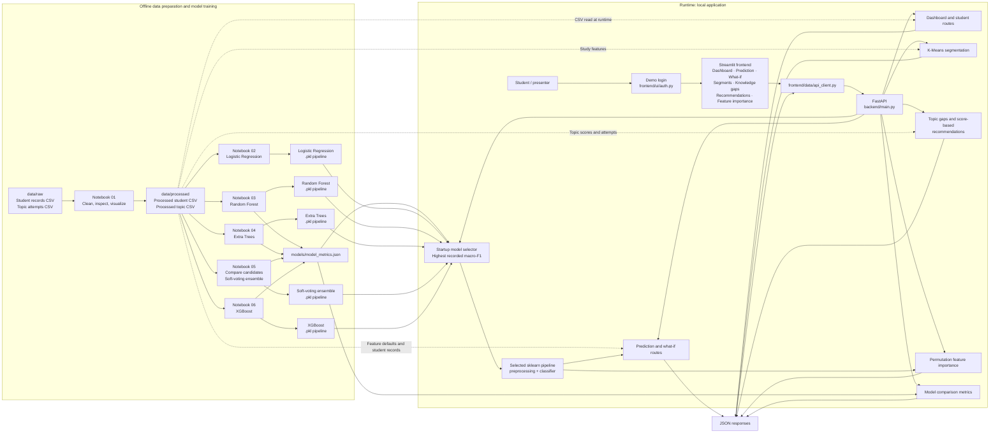

# LearnIQ — Personalized Learning & Student Performance Prediction System

 > **Machine Learning-Based Personalized Learning and Student Performance Prediction System**
>
> 
 **Project Title:**\
 **Machine Learning-Based Personalized Learning and Student Performance Prediction System**

 LearnIQ is a pure **Machine Learning** project that analyzes student academic and learning behavior to predict performance, identify student groups, detect knowledge gaps, recommend personalized learning paths, and perform what-if analysis.

 ## Dataset Used

 This project is designed to work with the Student Academic Performance Dataset from Kaggle:

 https://www.kaggle.com/datasets/ayushraj41/student-academic-performance-dataset

 The dataset is expected to provide academic and learning-behavior features such as attendance, study hours, quiz scores, assignment marks, previous performance, and outcome-related labels used for prediction and personalization tasks.

 ## About the Project

LearnIQ combines student-level academic and study-behavior records with topic-attempt data. Its model predicts a performance category, while the dashboard exposes student analytics, topic gaps, simple study suggestions, and scenario comparisons.

## System Architecture

The current MVP has two connected flows: notebooks prepare data and train candidate models offline, while FastAPI and Streamlit serve predictions and student analytics at runtime.



 ### Core ML Components

 - **Performance Prediction** — Classify `performance_category` and return model probabilities; this MVP does not predict an exact mark.
- **Student Segmentation** — Use K-Means to discover student learning/performance groups.
- **Knowledge Gap Detection** — Classify topic scores as strong, moderate, or weak.
- **Recommendation Engine** — Generate score-based practice suggestions for low-scoring topics.
- **What-if Analysis** — Compare model category predictions for current and changed inputs.
- **Feature Importance** — Show permutation importance; it is not SHAP or a causal explanation.

 ## Tech Stack

 - **Python**
- **Pandas / NumPy**
- **Matplotlib / Seaborn**
- **Scikit-learn**
- **XGBoost**
- **CSV files** for the current MVP data store
- **Streamlit**
- **FastAPI**

 No LLM, ChatGPT API, RAG, LangChain, or Generative AI is required.

The current MVP reads processed CSVs directly, uses demo-only login, and generates recommendations with simple score thresholds. A production database, stronger authentication, and a validated adaptive recommendation model are future work.

## Run the MVP Locally

Activate the project environment and install dependencies:

```bash
source .venv/bin/activate
pip install -r requirements.txt
```

Start the FastAPI service in one terminal:

```bash
uvicorn backend.main:app --reload --port 8000
```

Start the Streamlit frontend in a second terminal:

```bash
streamlit run app.py
```

The frontend is available at `http://localhost:8501`. API documentation is available at `http://localhost:8000/docs`. The current demo login is `abc@gmail.com` / `admin123`.

For the Random Forest, Extra Trees, and soft-voting ensemble artifacts, run notebooks `03_RandomForest_model.ipynb`, `04_ExtraTrees_model.ipynb`, and `05_VotingEnsemble_model.ipynb` in order. Notebook 05 saves every evaluated model and its held-out metrics. At startup, the API selects the available model with the highest macro-F1; if metrics are missing, it falls back to the Logistic Regression artifact. Restart the API after training.

### MVP API Routes

- `GET /api/v1/health` — service, data, and model readiness
- `GET /api/v1/dashboard` — dataset-level summary metrics
- `GET /api/v1/students` and `GET /api/v1/students/{student_id}` — student records and topic attempts
- `GET /api/v1/students/{student_id}/knowledge-gaps` — per-topic mastery status
- `GET /api/v1/students/{student_id}/recommendations` — score-based practice suggestions
- `GET /api/v1/segments` — live K-Means student groups
- `GET /api/v1/model-comparison` and `GET /api/v1/feature-importance` — model evaluation and permutation importance
- `POST /api/v1/predict` and `POST /api/v1/what-if` — model inference and scenario comparison

---

 # Development Plan

 Everything is developed inside this **single GitHub repository**.

 ## Step 1 — Project Setup

 - Create repository: `LearnIQ---Personalized-Learning-Performance-Prediction-System`
- Create Python virtual environment.
- Add `requirements.txt`.
- Create basic project structure.
- Configure `.gitignore`.

```
LearnIQ---Personalized-Learning-Performance-Prediction-System/
├── data/
├── notebooks/
├── src/
├── models/
├── database/
├── app/
├── tests/
├── docs/
├── requirements.txt
└── README.md
```

 ## Step 2 — Dataset

 Collect or create student academic + learning data.

 Include features such as:

 - Previous marks
- Attendance
- Study hours
- Quiz scores
- Assignment scores
- Attempt history
- Topic-level performance
- Study frequency

 Define the prediction targets:

 - Final marks
- Pass/fail
- Risk level
- Performance category

 ## Step 3 — Data Preprocessing & EDA

 - Clean missing and invalid data.
- Remove duplicates.
- Handle outliers.
- Encode categorical features.
- Scale features where required.
- Perform exploratory data analysis.
- Identify useful relationships and patterns.

 Store the work in:

```
notebooks/
src/data/
```

 ## Step 4 — Feature Engineering

 Create meaningful ML features such as:

 - Average quiz score
- Average assignment score
- Study consistency
- Previous performance
- Topic accuracy
- Attempt frequency
- Topic mastery

 Store feature engineering code in:

```
src/features/
```

 ## Step 5 — Performance Prediction

 Train and compare:

 - Logistic Regression
- Random Forest
- SVM
- XGBoost

 Evaluate using:

 - Accuracy
- Precision
- Recall
- F1-score
- ROC-AUC

 Save the best model inside:

```
models/
```

 ## Step 6 — Student Segmentation

 Use **K-Means Clustering** to discover student groups.

 Tasks:

 - Select clustering features.
- Scale the data.
- Find suitable `K`.
- Use Elbow Method.
- Calculate Silhouette Score.
- Analyze and visualize clusters.

 ## Step 7 — Knowledge Gap Detection

 Use topic-level performance to identify:

```
Strong → Moderate → Weak
```

 Example:

```
Arrays        → Strong
Linked List   → Strong
Stack         → Moderate
Trees         → Weak
Graphs        → Weak
```

 Also define topic prerequisites.

 ## Step 8 — Recommendation Engine

 Recommend the next topic using:

 - Knowledge gaps
- Previous scores
- Topic difficulty
- Attempt history
- Study frequency
- Prerequisites

 Example:

```
1. Revise Stack
2. Study Binary Trees
3. Practice Tree Traversal
4. Attempt Tree Quiz
```

 Evaluate recommendations using:

 - Precision@K
- Recall@K

 ## Step 9 — What-if Analysis

 Allow users to change inputs such as:

```
Study Hours
Quiz Average
Attendance
Assignment Average
```

 Then run the trained model again.

```
Current Inputs
      ↓
Trained ML Model
      ↓
Current Prediction

Changed Inputs
      ↓
Trained ML Model
      ↓
New Prediction
```

 ## Step 10 — Explainable ML

 Use **SHAP** to explain predictions.

 Example:

```
Risk: High

Previous Marks    ████████
Quiz Performance  ███████
Study Frequency   █████
Attendance        ███
```

 ## Step 11 — Database & Dashboard

 Create database tables for:

 - Students
- Performance
- Topics
- Topic attempts
- Predictions
- Recommendations

 Build the Streamlit dashboard with:

 - Student Overview
- Performance Prediction
- Student Segmentation
- Knowledge Gaps
- Recommendations
- What-if Analysis
- SHAP Explanation

 ## Step 12 — Testing & Deployment

 - Test preprocessing.
- Test ML predictions.
- Test clustering.
- Test recommendations.
- Test database integration.
- Test the complete application.
- Deploy the final dashboard.
- 
---

 # Final Goal

 The final system should be:

```
Data
 ↓
Preprocessing
 ↓
Feature Engineering
 ↓
Prediction + Clustering
 ↓
Knowledge Gap Detection
 ↓
Recommendation
 ↓
What-if Analysis
 ↓
SHAP Explainability
 ↓
Interactive Dashboard
```
